# Arquitectura

> Detalle completo en [`../MANUAL-TECNICO-ISHOP.md`](../MANUAL-TECNICO-ISHOP.md).
> Este documento resume el tipo de "modelo", la arquitectura, el diagrama de
> flujo, el pipeline de datos y las tecnologías usadas.

## Tipo de "modelo" seleccionado y justificación

Este proyecto **no entrena un modelo de machine learning propio**. En su
lugar usa una arquitectura **RAG (Retrieval-Augmented Generation)**: un
modelo de lenguaje de terceros (Google Gemini) redacta respuestas, pero
**nunca decide qué productos existen ni qué precios tienen** — esa
información siempre viene de una búsqueda vectorial sobre el catálogo real,
hecha con Qdrant.

**Por qué RAG y no un LLM sin RAG:** un LLM general puede inventar precios,
promociones o condiciones de garantía — inaceptable en un contexto de venta.
RAG obliga al modelo a redactar solo sobre evidencia recuperada; si no hay
evidencia suficiente, el sistema lo reconoce y ofrece un asesor en lugar de
improvisar (ver `RESULTADOS-Y-EVIDENCIAS.md` §6 para la comparación con
alternativas: FAQ estático y LLM sin RAG).

**Por qué no un modelo supervisado clásico (clasificación/regresión):** el
problema no es predecir una etiqueta o un número a partir de variables
tabulares, sino **responder en lenguaje natural con información verificable**
de un catálogo que cambia. Un modelo de clasificación no resuelve eso; un
pipeline de recuperación + generación sí.

## Arquitectura detallada (componentes)

El sistema son ocho contenedores Docker en un servidor, más un único servicio
externo:

| Componente | Función |
| --- | --- |
| Caddy | Única puerta pública: TLS y enrutado por dominio |
| Tienda estática | HTML/CSS/JS del catálogo (copia local de iShop) |
| Chatwoot + Sidekiq | Widget de chat visible al cliente y bandeja de asesores |
| PostgreSQL | Conversaciones, contactos, usuarios de Chatwoot |
| Redis | Cola de trabajos y canal en tiempo real de Chatwoot |
| n8n | Orquestador: contiene toda la lógica del asistente (workflow de 22 nodos) |
| Qdrant | Base de datos vectorial con el catálogo convertido en embeddings |
| Ollama | Genera los embeddings localmente (modelo `nomic-embed-text`, 768 dim.) |
| Google Gemini (externo) | Interpreta la intención del usuario y redacta la respuesta final |

## Diagrama de flujo del sistema completo



Fuente editable: [`img/arquitectura.mmd`](img/arquitectura.mmd) (sintaxis
[Mermaid](https://mermaid.js.org/)).

## Interfaz

El proyecto no usa un framework de demo tipo Streamlit/Gradio/Flask/FastAPI.
En su lugar expone **dos interfaces con roles distintos**, ambas integradas
sobre componentes existentes (Chatwoot, n8n) en vez de construidas desde
cero:

1. **Chat del cliente (Chatwoot, interfaz principal):** input de texto libre,
   procesamiento visible (indicador de "escribiendo"), output en lenguaje
   natural con enlace a la ficha del producto. Es la interfaz que resuelve el
   problema del proyecto y la que se demuestra en el video pitch.
2. **Formulario de carga de conocimiento (n8n Form Trigger, workflow 01,
   interfaz secundaria/administrativa):** campo de texto obligatorio + campo
   de archivo obligatorio (`.pdf, .txt, .md`), con una pantalla de cierre que
   muestra éxito o error de forma dinámica. No prueba el modelo: lo alimenta.

**Por qué esta decisión y no una app Streamlit/Gradio:** el caso de uso es
atención al cliente conversacional integrada en una tienda ya existente, no
un formulario de predicción de un modelo tabular. Un chat embebido reproduce
mejor la experiencia real (sin recargar página, con traspaso a humano en el
mismo hilo) que un formulario de input/output desconectado de la tienda. El
costo de esta decisión es que la interfaz no expone explícitamente nivel de
confianza, sección "Acerca de" ni botón "probar con ejemplo" dentro de la UI
misma — ese contenido vive en la documentación
([`../RESULTADOS-Y-EVIDENCIAS.md`](../RESULTADOS-Y-EVIDENCIAS.md) para
métricas, `chatbot/knowledge/preguntas-prueba.md` para ejemplos sugeridos) en
vez de en pantalla.

Detalle de uso de cada interfaz en [`manual_usuario.md`](manual_usuario.md);
framing completo y tabla de elementos cubiertos/faltantes frente a la rúbrica
en el [`README`](../README.md#interfaz-de-usuario).

## Pipeline de datos (desde input hasta output)

```
Cliente escribe en el widget de la tienda
  → Chatwoot recibe el mensaje (estado "pendiente")
  → n8n (workflow 04, 22 nodos) coordina la respuesta:
        1. Gemini interpreta intención, categoría y presupuesto
        2. Ollama convierte la consulta en un vector (embedding)
        3. Qdrant busca los 12 fragmentos más parecidos en `ishop_rag_v2`,
           filtrados por categoría
        4. n8n ordena, filtra por presupuesto y arma la evidencia
        5. Si la evidencia no supera el umbral de similitud (0.6), el
           sistema reconoce el límite y ofrece un asesor en vez de inventar
        6. Gemini redacta usando ÚNICAMENTE esa evidencia
  → La respuesta llega al mismo chat del cliente
```

El pipeline de indexación (offline, no por cada mensaje) es el que prepara el
catálogo para este flujo: `sync_knowledge.py` regenera los documentos de
texto desde la tienda y `index_knowledge.py` calcula los embeddings y
reconstruye la colección `ishop_rag_v2` (ver `analisis_datos.md` para el
detalle de por qué se indexa "un producto = un documento").

## Tecnologías y librerías utilizadas, con versiones

| Tecnología | Versión / imagen | Uso |
| --- | --- | --- |
| Python | 3.10+ | Scripts de sincronización, indexación, setup y pruebas (solo librería estándar, ver [`../requirements.txt`](../requirements.txt)) |
| Docker / Docker Compose | Compose ≥ 2.24 (requerido por `!override` en `compose.prod.yml`) | Orquestación de los 8 servicios |
| n8n | `n8nio/n8n` | Orquestador de la lógica del asistente (no-code) |
| Chatwoot | `chatwoot/chatwoot` | Widget de chat y bandeja de asesores |
| Qdrant | `qdrant/qdrant` | Base de datos vectorial (distancia coseno) |
| Ollama | `ollama/ollama`, modelo `nomic-embed-text:latest` | Embeddings locales (768 dimensiones) |
| Google Gemini | API (vía `GEMINI_API_KEY`) | Interpretación de intención y redacción de respuestas |
| Caddy | `caddy` | Proxy inverso, HTTPS automático (Let's Encrypt) |
| PostgreSQL / Redis | imágenes oficiales | Persistencia y colas de Chatwoot |

## Decisiones técnicas principales (resumen)

| Decisión | Alternativas descartadas | Por qué |
| --- | --- | --- |
| RAG con fuentes propias | LLM sin RAG; FAQ estática | Respuestas en lenguaje natural **verificables** contra el catálogo |
| Un producto = un documento vectorial | Chunks de tamaño fijo | Evita mezclar un producto con otro en la misma respuesta |
| Embeddings locales (Ollama) | API de embeddings de pago | Sin costo recurrente ni fuga de datos del catálogo |
| Gemini solo para interpretar y redactar | Modelo local para todo | Un servidor pequeño no sostiene un LLM de redacción |
| n8n como orquestador | Código a medida | La lógica es un diagrama auditable, modificable sin recompilar |
| Chatwoot para el chat y la bandeja | Widget propio | Traspaso IA ↔ humano probado, en el mismo hilo de conversación |

Tabla ampliada y razones de cada descarte en
[`../README.md`](../README.md#decisiones-técnicas-principales).
